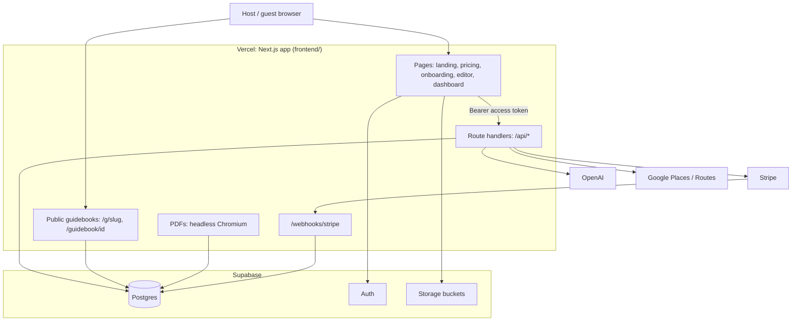

# Guidewise Architecture

Guidewise is one Next.js 15 (App Router) application in `frontend/`, deployed on Vercel from GitHub
(`main` → previews, `prod` → production). Data, auth and file storage live in Supabase.

## Code layout

| Path | What it holds |
| --- | --- |
| `src/app/` | Pages and route handlers (`api/`, `g/[slug]`, `guidebook/[id]`, `webhooks/stripe`, `sample-guidebook`) |
| `src/lib/server/` | Server-only code: `apiRoute.ts` (auth + error wrapper), `db.ts` (postgres.js over the Supabase pooler), `auth.ts` (Supabase JWT check), guidebook CRUD, billing/Stripe, plans and usage metering, listing import, AI recommendations, Google Places, rate limiting, SSRF guard |
| `src/lib/guidebook/` | Guidebook rendering: context builder, Nunjucks environment, rules/photo helpers, the sample guidebook |
| `src/lib/pdf/` | PDF generation: Chromium launcher, the design system in `guide/` (themes, layout), the AI layout composer, legacy PDF templates |
| `src/templates/` | Guidebook templates: Signature (the default for new guidebooks, self-contained CSS and fonts), Lifestyle, Welcoming, and Classic (no longer offered, still rendered for guidebooks on it); legacy PDF templates |
| `src/components/`, `src/hooks/` | React UI (editor sections, phone preview, dashboard) |
| `tests/` | Vitest suites against an in-process Postgres (PGlite), golden HTML snapshots, PDF layout checks, `integration/native-routes.sh` |
| `supabase/migrations/` | Database migrations (applied to the dev branch first, to prod only with approval) |

## Request handling

- **Authenticated API routes** use `withUser` (needs the database) or `withAuth` from
  `src/lib/server/apiRoute.ts`: missing configuration → `503`, missing/invalid token → `401`,
  `ServiceError` → its status and message, anything else → `500` JSON.
- **Ownership** is enforced in SQL (`where user_id = …`); another user's guidebook is a `404`.
- **Public guidebooks** (`/g/<slug>`, `/guidebook/<id>`) are rendered on demand from the database with
  the selected template, served with an ETag and `X-Robots-Tag: noindex`. Free-plan pages are metered per
  request (`private, no-store`); paid-plan pages are CDN-cacheable and record views with a small beacon
  (`POST /api/view/<slug>`). See `docs/pricing.md`.
- **Editor preview**: `GET /api/guidebooks/<id>/html` (owner only) renders the same HTML into the phone
  frame; the editor autosaves with `PUT /api/guidebooks/<id>`.

## Main flows

- **Create**: `/onboarding` → `POST /api/import-listing` (Airbnb/VRBO link: page fetched behind an SSRF
  guard, parsed by OpenAI, places added from Google) or `POST /api/generate` (manual). Every guidebook is
  live at its slug from creation.
- **Edit**: `/edit/<id>`: sections in the sidebar, live phone preview, style switcher
  (`POST /api/guidebook/<id>/template`), autosave.
- **PDF**: `/api/guidebook/<id>/pdf` (layouts, optional QR, optional AI-designed layout cached in
  `guidebook_pdf_plan`) and `/api/guidebook/<id>/print-pdf`; rendered with `@sparticuz/chromium`.
- **Billing**: `/api/billing/create-checkout-session`, `/create-portal-session`, `/summary`; Stripe
  webhooks update `profiles.plan` (idempotent, a failure returns `500` so Stripe retries).

## Database (main tables)

- `guidebook`: one row per guidebook (`user_id`, `property_id`, `host_id`, `wifi_id`, `template_key`,
  `public_slug`, check-in/out, text sections, JSON sections such as `things_to_do`, `places_to_eat`,
  `house_manual`, `checkout_info`, `included_tabs`, `custom_sections`, `rules_json`).
- `property`, `host`, `wifi`: per-user records referenced by guidebooks.
- `profiles`: plan and Stripe ids per user.
- `guidebook_view_daily`, `view_dedupe`, `ai_usage_monthly` (usage metering; creation limits are
  counted from `guidebook.created_time`) and `guidebook_pdf_plan` (cached AI PDF layouts): RLS on, no
  policies; only the server touches them.

Leftover, unused columns are listed in `docs/pricing.md`.

## Security notes

- Secrets are only in Vercel/GitHub/Supabase settings; `NEXT_PUBLIC_*` values are public by design.
- The service-role client bypasses RLS, so every server query filters by the authenticated user.
- Outbound fetches of user-supplied URLs (listing import, PDF assets) go through `ssrf.ts`.
- AI inputs are masked (no contact details or secrets are sent) and AI output is validated before use.
- Per-user rate limits on AI, Places, import and PDF routes; creation limits are counted in the database.
